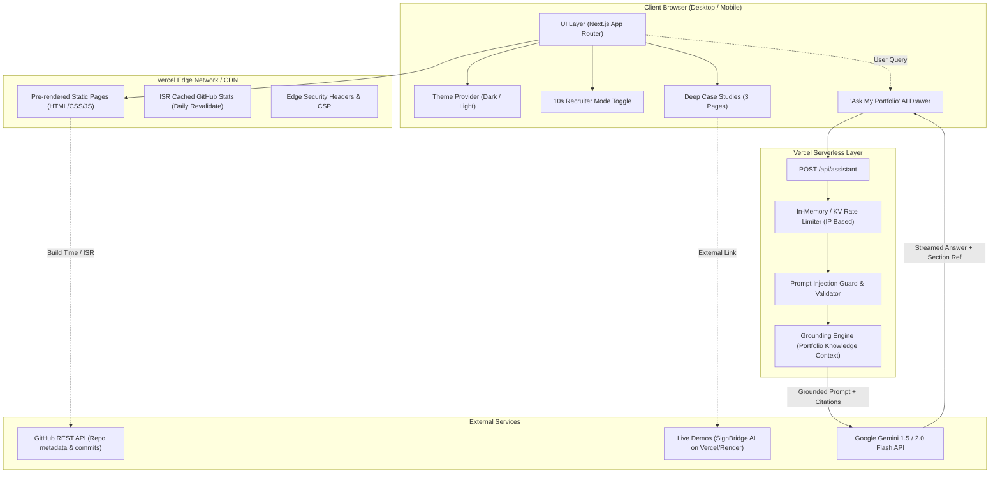

# System Architecture & Technical Specifications — Rohan Pawar Portfolio

**Status:** Draft / Pending Approval  
**Architecture Version:** 1.0.0  
**Host & Infrastructure:** Vercel (Edge Network + Serverless Functions)  

---

## 1. Technology Stack Rationale

| Layer | Chosen Technology | Justification | Alternatives Considered |
| :--- | :--- | :--- | :--- |
| **Framework** | **Next.js 14/15 (App Router)** `[User-provided]` | Hybrid Static Site Generation (SSG) for sub-second page loads + Serverless API Routes for the AI assistant. Built-in image optimization and metadata support. | Vite SPA (no native secure serverless routes for AI API keys without external backend), Remix/Astro (good, but Next.js standard on Vercel). |
| **Language** | **TypeScript (Strict Mode)** `[User-provided]` | End-to-end type safety for project case studies, experience records, and AI payload schemas. Prevents runtime regressions. | JavaScript (lacks type safety for complex content models). |
| **Styling** | **Tailwind CSS + Vanilla CSS Modules** `[User-provided / Recommendation]` | Utility-first styling enables rapid development of glassmorphism effects, custom themes (dark/light), and strict design token consistency, while scoped CSS handles complex neural canvas/SVG animations. | Pure Vanilla CSS (higher boilerplate for responsive layouts), Styled Components (runtime CSS-in-JS performance penalty). |
| **AI Assistant** | **Google Gemini Flash API (`google-genai` / REST)** `[User-provided]` | Sub-500ms TTFT (Time to First Token), generous free-tier limits, large context window for ingesting complete portfolio markdown docs into system prompt. | OpenAI GPT-4o-mini (lower free tier allowance), Local client-side model (heavy web bundle, slow on mobile). |
| **Icons & Visuals** | **Lucide React + Custom SVG** `[Recommendation]` | Lightweight tree-shakeable icons with zero external CSS baggage; custom SVG for animated architecture pipelines. | FontAwesome (bundle bloat), React Icons (mixed styling standards). |
| **Hosting & CI/CD** | **Vercel + GitHub Actions** `[User-provided]` | Native zero-config deployment, automated preview environments for PRs, edge caching, and automated Lighthouse CI runs. | Netlify, Render, GitHub Pages (lacks serverless without extra configuration). |

---

## 2. High-Level System Architecture



---

## 3. Content Data Model & TypeScript Schemas

All content is statically typed and stored in structured data modules (`src/data/`) to enable zero-runtime-database rendering and easy maintenance.

### 3.1 Project Case Study Schema
```typescript
export interface ProjectMetric {
  label: string;
  value: string;
  description: string;
}

export interface CaseStudySection {
  problem: string;
  approach: string;
  architectureDiagram: string; // Mermaid code or SVG component key
  keyDecisions: Array<{ decision: string; rationale: string; tradeOff: string }>;
  resultsAndMetrics: ProjectMetric[];
  limitationsAndFuture: string[];
}

export interface Project {
  id: string; // 'signbridge-ai' | 'vaultmind-rag' | 'luminai'
  title: string;
  tagline: string;
  category: 'AI/ML' | 'RAG / LLM' | 'Analytics & BI';
  featured: boolean;
  status: 'Live' | 'Open Source' | 'Completed';
  tags: string[];
  links: {
    github?: string;
    demo?: string;
    paper?: string;
  };
  headlineMetric: string;
  caseStudy: CaseStudySection;
}
```

### 3.2 Experience & Leadership Schema
```typescript
export interface ExperienceItem {
  id: string;
  company: string;
  role: string;
  period: string; // e.g., 'TBD: June 2026 – Aug 2026'
  type: 'Internship' | 'College Leadership' | 'Open Source';
  location: string;
  highlights: string[];
  skillsApplied: string[];
  isClientProject?: boolean;
}
```

### 3.3 Skill Matrix Schema
```typescript
export interface Skill {
  name: string;
  level?: 'Proficient' | 'Familiar';
  backedByProjects: string[]; // references project IDs or experience IDs
}

export interface SkillCategory {
  category: 'AI / Machine Learning' | 'Backend & Systems (Python)' | 'Data Analytics & BI' | 'Tools & Infrastructure';
  skills: Skill[];
}
```

---

## 4. "Ask My Portfolio" AI Assistant Architecture

The assistant acts as a live technical showcase of Rohan's RAG and prompt engineering abilities while giving recruiters an instant Q&A interface.

### 4.1 Request Pipeline
1. **Client Submission:** User submits query via floating drawer modal (e.g. *"Has Rohan deployed any models to production?"*).
2. **Rate Limiting:** `/api/assistant` checks client IP against a 10 requests / 15-minute sliding window. Returns HTTP 429 if exceeded.
3. **Prompt Injection & Moderation Check:**
   - Detects delimiter escapes (`---`, ````system`), system override attempts (`ignore previous instructions`), and abusive language.
   - Rejects queries outside Rohan's professional portfolio domain.
4. **Knowledge Base Assembly:**
   - Pre-compiled concise markdown context representing Rohan's verified work (Projects, Tech Stacks, Experience at LuminAI/SOITA/InAmigos/SVCE, Certifications).
5. **LLM Invocation:**
   - Invokes Gemini Flash with temperature `0.1` and explicit system instructions.
6. **Grounding & Citation Rule:**
   - Must cite the exact source section (e.g., `[Source: SignBridge AI Case Study]`).
   - If queried about personal phone numbers, home address, or unverified claims, responds: *"That information is private or not verified in Rohan's portfolio."*
7. **Client Rendering:** Streamed response rendered with markdown support and citation badges.

---

## 5. Security & Privacy Architecture

1. **API Keys Isolation:**
   - `GEMINI_API_KEY` stored exclusively in Vercel Environment Variables (`.env.local` for local dev).
   - `.env` strictly added to `.gitignore`. An `.env.example` with blank keys committed to git.
2. **Client Data Sanitization:**
   - No proprietary item codes, internal database schemas, or client names from LuminAI beyond authorized public summaries.
   - Contact email and telephone configured via environment/placeholder configuration rather than hardcoded public strings in repo history.
3. **HTTP Security Headers:**
   - Strict Content Security Policy (CSP), `X-Frame-Options: DENY`, `X-Content-Type-Options: nosniff`, `Referrer-Policy: strict-origin-when-cross-origin`.

---

## 6. Performance & Lighthouse Architecture

- **Fonts:** Next.js `next/font` for zero layout shift (CLS 0.00).
- **Images:** Next.js `<Image />` with automatic WebP/AVIF compression and responsive sizing.
- **Dynamic Imports:** Code-split heavy interactive elements (Mermaid renderers, AI Assistant modal) so initial hero LCP is < 1.2s.
- **Reduced Motion:** Global CSS hook respecting `@media (prefers-reduced-motion: reduce)` disabling particle canvas or scroll transformations.
