# Execution Phases & Verification Roadmap — Rohan Pawar Portfolio

**Status:** Draft / Pending Approval  
**Strategy:** Phased Delivery with Verification Gates  

---

## Phase Overview

```mermaid
graph LR
    P0[Phase 0: Tooling & Setup] --> P1[Phase 1: Design System & Shell]
    P1 --> P2[Phase 2: Hero & Projects Overview]
    P2 --> P3[Phase 3: Deep Case Studies]
    P3 --> P4[Phase 4: Experience, Skills, Certs, Contact]
    P4 --> P5[Phase 5: 'Ask My Portfolio' AI Assistant]
    P5 --> P6[Phase 6: Recruiter Mode, GitHub Sync, SEO]
    P6 --> P7[Phase 7: Performance, A11y, Security Audit]
    P7 --> P8[Phase 8: Vercel Deploy & Launch]
```

---

## Detailed Phase Breakdown

### Phase 0: Project Scaffolding & Tooling Setup
- **Objective:** Establish the clean Next.js 14/15 TypeScript application foundation, styling pipeline, linting, and git baseline.
- **Tasks:**
  - Initialize Next.js project with App Router, TypeScript, and Tailwind CSS + CSS Modules.
  - Configure ESLint, Prettier, and strict TypeScript rules (`strict: true`).
  - Set up directory structure: `/src/app`, `/src/components`, `/src/data`, `/src/styles`, `/src/types`, `/src/lib`.
  - Create `.env.example` with placeholders for `GEMINI_API_KEY` and optional analytics.
  - Commit documentation suite (`PRD.md`, `Architecture.md`, `Rules.md`, `Phases.md`, `Design.md`, `Memory.md`).
- **Acceptance Criteria:**
  - `npm run dev` starts dev server with zero warnings or errors.
  - `npm run build` succeeds cleanly.
  - All documentation files present and committed.

---

### Phase 1: Design System, Layout Shell & Theme Engine
- **Objective:** Implement futuristic AI aesthetic tokens, responsive header/footer navigation shell, and dark/light theme switching.
- **Tasks:**
  - Define design tokens in `tailwind.config.ts` and `src/styles/globals.css` (custom dark palette, glassmorphism blur tokens, accent glows, typography).
  - Build `ThemeProvider` with system preference detection, localStorage persistence, and zero-flash toggle.
  - Implement accessible `Header` with brand mark, section navigation links, and theme toggle button.
  - Implement sticky / floating `Footer` with copyright, status indicator ("Available for AI/ML roles"), and quick social icons.
- **Acceptance Criteria:**
  - Dark mode renders by default; toggling switches between dark and light themes smoothly without layout shift.
  - Mobile hamburger drawer functions seamlessly with keyboard accessibility.
  - Respects `@media (prefers-reduced-motion)`.

---

### Phase 2: Content Model, Hero Section & Projects Overview
- **Objective:** Populate typed content schemas, build the impactful Hero section with neural motif, and construct project cards preview grid.
- **Tasks:**
  - Create TypeScript content stores in `src/data/`: `projects.ts`, `experience.ts`, `skills.ts`, `certifications.ts`.
  - Build `Hero` component:
    - Primary positioning headline (AI/ML Engineer | Python Backend | Data Analyst).
    - Dual primary CTAs: "View Projects" and "Download Resume".
    - Social links (GitHub, LinkedIn, Email).
    - Subtle interactive neural graph / landmark motif canvas in background.
  - Build `FeaturedProjectsOverview` grid displaying cards for:
    - SignBridge AI (with live badge and repo link).
    - VaultMind-RAG (with architecture highlight badge).
    - LuminAI (with B2B forecasting highlight).
- **Acceptance Criteria:**
  - Hero loads instantaneously with zero cumulative layout shift (CLS = 0).
  - All project cards display live status, headline metrics, tech badges, and deep-dive links.

---

### Phase 3: Three Deep Case Study Pages & Architecture Diagrams
- **Objective:** Create detailed, dedicated case study pages for SignBridge AI, VaultMind-RAG, and LuminAI following the "Proof Over Claims" structure.
- **Tasks:**
  - Create dynamic route `/projects/[id]` or individual static pages.
  - Implement standardized case study template:
    - Problem Statement & Real-world context.
    - Technical Approach & Implementation details.
    - Interactive architecture diagram (Mermaid.js or animated SVG).
    - Engineering Decisions & Trade-offs matrix.
    - Measurable Results & Headline Metrics.
    - Honest Technical Limitations & Future Work.
    - Verifiable Links (GitHub repo, live deployment, documentation).
  - Ensure LuminAI write-up strictly adheres to client-safe generic terminology.
- **Acceptance Criteria:**
  - All 3 case studies are navigable and render complete diagrams and metrics.
  - External links to SignBridge live demo (`vercel.app`), backend (`onrender.com`), and GitHub repos testable and active.

---

### Phase 4: Experience, Skills Matrix, Certifications & Contact
- **Objective:** Complete the professional credibility sections highlighting internships, student tech leadership, skills backed by projects, and certifications.
- **Tasks:**
  - Build `ExperienceTimeline` component with verified entries:
    - LuminAI (AI & Analytics Intern)
    - SOITA (AI Agent Development Intern)
    - InAmigos Foundation (Web Development Intern - 2 weeks)
    - Student Tech Lead / "Student Tech Guy" (SVCE, Bengaluru)
  - Build `SkillsMatrix` grouped by AI/ML, Backend, Data Analytics, Tools — where each skill chip shows hover context linking to the corresponding project/internship.
  - Build `Certifications` section highlighting Oracle Certified Foundations Associate in Agentic AI and NPTEL NLP course (marked `[In Progress]`).
  - Build `ResumePreview` (embedded viewer + download CTA) and `ContactSection` (mailto card + LinkedIn/GitHub).
- **Acceptance Criteria:**
  - Every listed skill links to evidence in a project or internship.
  - Resume button triggers PDF download.
  - Contact links properly formatted without hardcoding private phone numbers.

---

### Phase 5: "Ask My Portfolio" AI Assistant (RAG Pipeline)
- **Objective:** Implement the interactive AI chatbot drawer grounded strictly on Rohan's verified portfolio.
- **Tasks:**
  - Build client-side drawer/modal component (`AssistantModal`) with floating trigger button, pre-populated recruiter quick-prompts, and chat stream UI.
  - Create serverless route `POST /api/assistant`:
    - Integrate Gemini Flash via official SDK or REST client.
    - Inject compiled portfolio system context (`knowledgeContext.ts`).
    - Enforce rate-limiting and character limits.
    - Implement anti-injection sanitization and strict grounding prompt.
    - Stream responses with source citations (e.g. `[Source: SignBridge AI]`).
    - Implement graceful fallback if API quota is reached or network is offline.
- **Acceptance Criteria:**
  - Correctly answers: "What did Rohan build in VaultMind-RAG?", citing the custom sliding-window chunker.
  - Refuses off-topic questions (e.g. "What is the capital of France?") and injection attempts.
  - Does not leak private phone numbers or fabricated claims.

---

### Phase 6: 10-Second Recruiter Mode, GitHub Sync & SEO
- **Objective:** Add high-impact recruiter features and optimize discoverability.
- **Tasks:**
  - Build `RecruiterModeToggle` top bar:
    - Activating toggle snaps view to an ultra-condensed executive summary (Role, 3 Projects, Stack, Resume, Contact).
  - Build `GitHubActivity` widget with ISR caching to display recent commit activity without hitting unauthenticated rate limits.
  - Generate comprehensive SEO metadata: OpenGraph images, Twitter cards, `sitemap.xml`, `robots.txt`, and JSON-LD `Person` schema.
- **Acceptance Criteria:**
  - Recruiter mode switch transitions smoothly and provides instant review.
  - Valid structured data verified via Schema.org validator test.

---

### Phase 7: Performance, Accessibility & Security Audit
- **Objective:** Rigorously verify all non-functional requirements and test coverage.
- **Tasks:**
  - Run Google Lighthouse audit on Mobile and Desktop; ensure scores ≥ 90 across all categories.
  - Conduct full keyboard accessibility audit (Tab focus order, Enter/Space activation, ARIA attributes).
  - Run security scan (verify zero API keys in client bundles, verify rate-limiting on API routes).
  - Execute test suite (verifying AI assistant grounding, refusal responses, and schema data validity).
- **Acceptance Criteria:**
  - Lighthouse Performance ≥ 90, Accessibility ≥ 90, Best Practices ≥ 90, SEO ≥ 90.
  - Zero console errors or unhandled promise rejections.

---

### Phase 8: Deployment & Launch Readiness
- **Objective:** Deploy production application to Vercel and verify live operations.
- **Tasks:**
  - Connect GitHub repository to Vercel project.
  - Configure environment variables (`GEMINI_API_KEY`) securely on Vercel dashboard.
  - Verify live preview deployment across desktop and mobile devices.
  - Run final end-to-end verification checklist.
- **Acceptance Criteria:**
  - Live public URL functioning with active HTTPS, working assistant, and fast asset loading.
